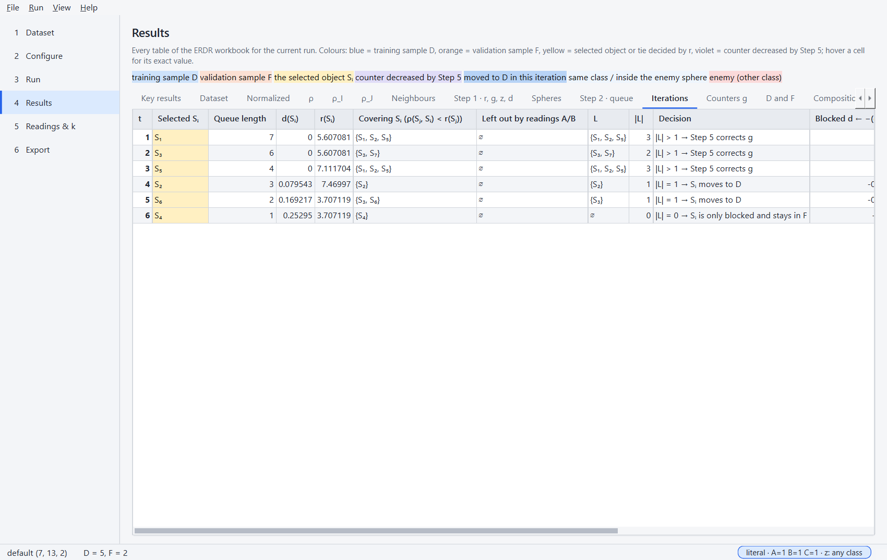

# ERDR — Enemy-Radius Density Reduction

Python implementation of the **Enemy-Radius Density Reduction (ERDR)** algorithm of §1.1 of
N. A. Ignatev's article *«Ансамбли алгоритмов распознавания на основе синтетических признаков и
контекстов k ближайших соседей»* — library, `erdr` command line and desktop GUI. ERDR divides a
labelled sample E₀ into a **training sample D** and a **validation sample F = E₀ \ D**. The Excel
workbook `ERDR algorithm [Heart-Disease (7, 13, 2)].xlsx` is the executable specification: the
package reproduces every one of its computed sheets (937 checks).

> **Windows app, no Python needed:** download `erdr-gui-<version>-windows.zip` from the
> [latest release](https://github.com/ktuhtabayev/erdr/releases/latest), unpack it and start
> `erdr-gui.exe`.

```text
Step 0  x′ = (x − min)/(max − min),  ρ = Σ_I |x′ − y′| + Σ_J [x ≠ y]      (Zhuravlev metric)
Step 1  r(Sᵢ) nearest enemy · g(Sᵢ) own class inside · z(Sᵢ, k) k-th neighbour · d = |z − r|/(z + r)
Step 2  queue: d ↑, r ↑, index ↑              Step 3  Sᵢ = first of the queue
Step 4  L = {Sⱼ ∈ F ∩ K_t | ρ(Sⱼ, Sᵢ) < r(Sⱼ), g(Sⱼ) > 1};  block Sᵢ;  |L| = 1 → Sᵢ to D
Step 5  |L| > 1 → g(Sⱼ) − 1 for Sⱼ ∈ L;  g(Sⱼ) = 1 → Sⱼ to D             Step 6  D, F = E₀ \ D
```

> [!WARNING]
> **The article leaves three points open; they are switches, and the default is the literal text.**
> - **A** — is Sᵢ a member of its own L? (literal: yes, when g(Sᵢ) > 1)
> - **B** — do processed objects keep covering? (literal: yes, they stay in F)
> - **C** — where does «Перейти к шагу 2» stand in Step 5? (default: after the whole set L)
>
> Plus the class scope of z(Sᵢ, k). On all 270 objects the literal reading keeps 165–201 objects
> in D where the article's Table 1 reports 75–104; **B = 2 with the own-class z** (preset
> `closest`) comes within 0–16 objects. Every non-literal reading is flagged in the CLI, the GUI
> and every export. See [docs/DECISIONS.md](docs/DECISIONS.md) (ADR-003, ADR-004, ADR-017).

## Status

| Part | Content | State |
|---|---|---|
| Core | Step 0 (8 normalizers, 12 metrics), Steps 1–6, the readings A, B, C and z, the 17 cases | ✓ |
| Data | extended `.csv`/`.dat` layout (read and written byte for byte), CSV/Excel tables, the ERDR workbook, Parquet; dataset folder and built-in datasets | ✓ |
| Configuration | typed (pydantic), YAML/TOML/JSON, presets `literal` and `closest`, hashing | ✓ |
| Services | runner, repeatable run folders, readings comparison, k sweeps, workbook validation | ✓ |
| Exports | CSV, JSON, Markdown, LaTeX, Excel (laid out like the workbook), PNG/SVG figures, HTML report, training/validation datasets | ✓ |
| Interfaces | `erdr` CLI, desktop GUI (PySide6) in the template's design with light and dark themes, portable Windows executable | ✓ |
| Quality | 157 tests (golden: workbook, guide, Table 1; property-based; GUI), 94 % coverage, mypy strict, ruff, Windows CI | ✓ |

## The desktop application without Python

Download `erdr-gui-<version>-windows.zip` from the
[latest release](https://github.com/ktuhtabayev/erdr/releases/latest) (or build it with
`scripts\build_exe.py`), unpack it anywhere and start `erdr-gui.exe`. Nothing is installed; the
Heart-Disease datasets are built in. The window is light by default; **View → Dark theme** (or
**Ctrl+T**) and **Follow Windows** switch it, and **Ctrl++ / Ctrl+−** zoom.



## Quick start (Windows PowerShell)

The project is developed and tested on Windows with Python 3.12 (like the template project).

```powershell
py -3.12 -m venv .venv
.\.venv\Scripts\python.exe -m pip install --upgrade pip
.\.venv\Scripts\python.exe -m pip install -e ".[dev]"
```

Commands:

```powershell
.\.venv\Scripts\erdr.exe run                                   # the workbook: default dataset, literal reading
.\.venv\Scripts\erdr.exe run heart-disease-270 --brief          # all 270 objects (|D| = 198 for k = 3)
.\.venv\Scripts\erdr.exe run heart-disease-270 -p closest       # B = 2 + own-class z (|D| = 75 = Table 1)
.\.venv\Scripts\erdr.exe run -k 5 -r 211 --metric gower --normalizer rank --k-rule warn
.\.venv\Scripts\erdr.exe readings --both-z                      # all 16 readings on the sample
.\.venv\Scripts\erdr.exe sweep heart-disease-270 --k 3-41       # |D| for every odd k
.\.venv\Scripts\erdr.exe validate                               # every sheet of the workbook (937 checks)
.\.venv\Scripts\erdr.exe run --save --export all                # run folder + every export format
.\.venv\Scripts\erdr.exe export -f xlsx,html --readings --sweep # export the latest run again
.\.venv\Scripts\erdr.exe data list ; .\.venv\Scripts\erdr.exe plugins
.\.venv\Scripts\erdr.exe config init my.yaml ; .\.venv\Scripts\erdr.exe run -c my.yaml
.\.venv\Scripts\erdr.exe gui                                    # the desktop application
```

From Python:

```python
from erdr.data import load_builtin
from erdr.services.experiment import run_experiment
from erdr.config import preset

run = run_experiment(dataset=load_builtin("heart-disease-7"))  # literal reading, k = 3
run.result.training  # array([0, 1, 4, 5, 6]) → D = {S₁, S₂, S₅, S₆, S₇}
run.result.iterations[2].L  # (0, 1, 4) → L = {S₁, S₂, S₅}
run.training_dataset  # D as a Dataset (write it with erdr.data.write_extended)

closest = run_experiment(preset("closest"), load_builtin("heart-disease-270"))
closest.result.training.size  # 75
```

## Layout

```text
configs/            configurations: default (the workbook), Heart-Disease 270 literal / closest
datasets/           default.csv/.dat = Heart-Disease (7, 13, 2); Heart-Disease/… (270, 13, 2)
docs/               documentation (mkdocs), DECISIONS.md, GUI screenshots
resources/          the ERDR workbook, the step-by-step guide, the article (read-only)
scripts/            Windows executable build, GUI screenshots
src/erdr/
  core/             pure numerical core: normalizers, metrics, Step 0, Steps 1–6, readings, cases
  config/           typed configuration, presets, YAML/TOML/JSON
  data/             dataset schema, loaders, writers, dataset folder, built-in datasets
  services/         runner, run folders, readings and k sweeps, workbook validation
  export/           tables, CSV/JSON/Markdown/LaTeX, Excel, figures, HTML report
  cli/              the erdr command
  gui/              desktop application (PySide6)
tests/              pytest suite: golden (workbook, guide, Table 1), unit, property-based, GUI
```

## Documentation

[The algorithm](docs/algorithm.md) · [Architecture](docs/architecture.md) ·
[Configuration](docs/configuration.md) · [Datasets](docs/datasets.md) ·
[Command line](docs/cli.md) · [Desktop application](docs/gui.md) ·
[Validation](docs/validation.md) · [Exporting](docs/exporting.md) ·
[Extending](docs/extending.md) · [Decisions](docs/DECISIONS.md) · [Development](docs/development.md)

The article is in preparation; its text is not part of the public repository.

## License

MIT — see [LICENSE](LICENSE). Heart-Disease is the Statlog (Heart) dataset of the UCI Machine
Learning Repository (CC BY 4.0).
