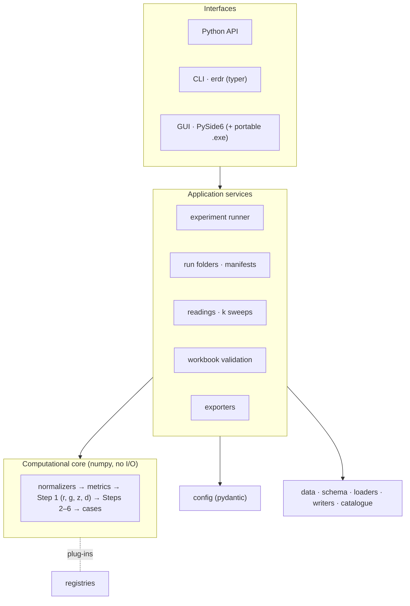
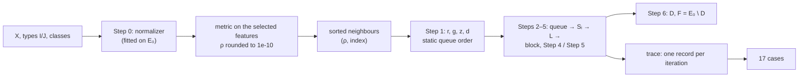
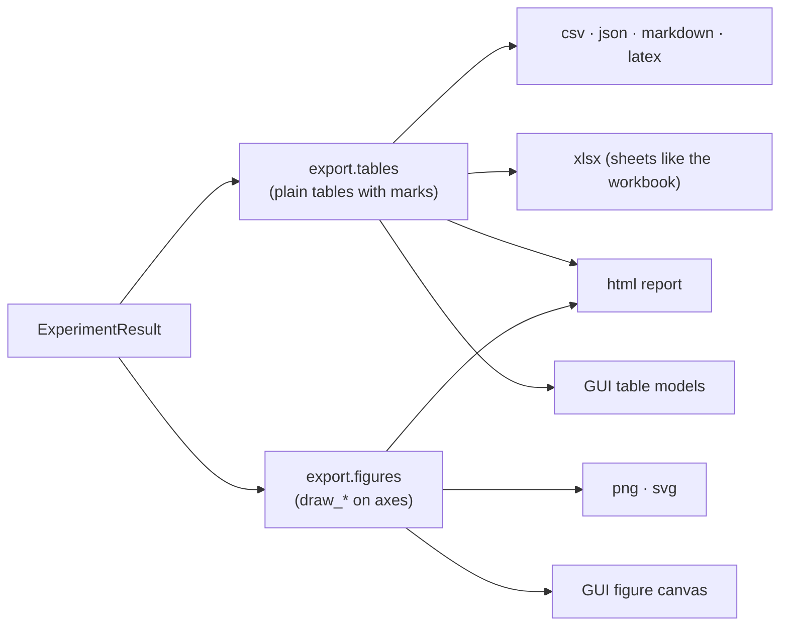

# Architecture

## Layers

The computational core is pure and deterministic; everything that touches files, users or screens
sits above it. The CLI and the GUI call the same services.

| Package | Role |
|---|---|
| `erdr.core` | normalizers, metrics, Step 0 pipeline, sorted neighbours, the k rule, Step 1, Steps 2–6 with a replayable trace, readings, cases, plug-in registries |
| `erdr.config` | typed configuration (pydantic v2), presets, YAML/TOML/JSON, canonical hash |
| `erdr.data` | `Dataset`, loaders (extended layout, CSV, Excel, ERDR workbook, Parquet), writers, the `datasets` folder, built-in datasets |
| `erdr.services` | runner, run folders, readings comparison and k sweeps, dataset summaries, workbook validation |
| `erdr.export` | plain tables, CSV/JSON/Markdown/LaTeX, Excel, figures, HTML report, datasets |
| `erdr.cli` | the `erdr` command |
| `erdr.gui` | the desktop application (optional extra `[gui]`) |

The core imports only numpy, pydantic (plug-in parameter types) and its own modules; it never
reads a file. `erdr.data.schema` is pure as well.

## Information flow

## The trace

`run_erdr` records per iteration only what changes — the selected object, L, the objects that
cover Sᵢ, those left out by readings A/B, the decision, the counter changes, the moves, the sizes
— so memory stays linear in m per iteration. `ERDRResult.state_after(t)` replays the records into
the full state of any iteration (in F, processed, g, d), `queue_before(t)` gives the queue of
Step 2 and `counter_history()` the counters after every iteration — exactly the blocks of the
sheets *ERDR Iterations* and *ERDR Trace*.

## Exports and the GUI share one model

A table cell carries a *mark* — what it means (class K1, training sample, selected object, counter
decreased, tie decided by r …), not how it looks — and a column header the kind of quantity it
holds (quantitative or nominal feature, class, r g z, d, parameter); `export.theme` gives every
mark its colours, so the GUI, the Excel writer, the HTML report, the figures and the console show
the same categories in the same colours (ADR-019). Figures are drawn on axes the caller provides, so the GUI embeds the very drawings
the exports save (ADR-012).

## Extension points

Every exchangeable part is a plug-in chosen by name ([Extending](extending.md)):

| Kind | Default | Built in |
|---|---|---|
| normalizers | min–max over E₀ | none, z-score, robust, max-abs, decimal scaling, rank, unit length |
| metrics | Zhuravlev | weighted Zhuravlev, HEOM, Gower (any features); Manhattan, Euclidean, Chebyshev, Minkowski, Canberra, cosine, Mahalanobis (set I); Hamming (set J) |
| dataset formats | detected from the file | extended `.csv`/`.dat`, CSV table, Excel table, ERDR workbook, Parquet (extra `[parquet]`) |
| export formats | all | CSV, JSON, Markdown, LaTeX, Excel, figures, HTML, datasets |
| built-in datasets | Heart-Disease (7, 13, 2) | Heart-Disease (270, 13, 2), the guide's example (7, 4, 2) |
| readings | literal | A, B, C, scope of z — 16 combinations |

Plug-ins register in a `Registry`; external packages add them through the entry-point group
`erdr.<kind>` (`erdr.metrics`, `erdr.normalizers`, `erdr.loaders`, `erdr.exporters`). A plug-in's
parameter type also generates its form in the GUI.
