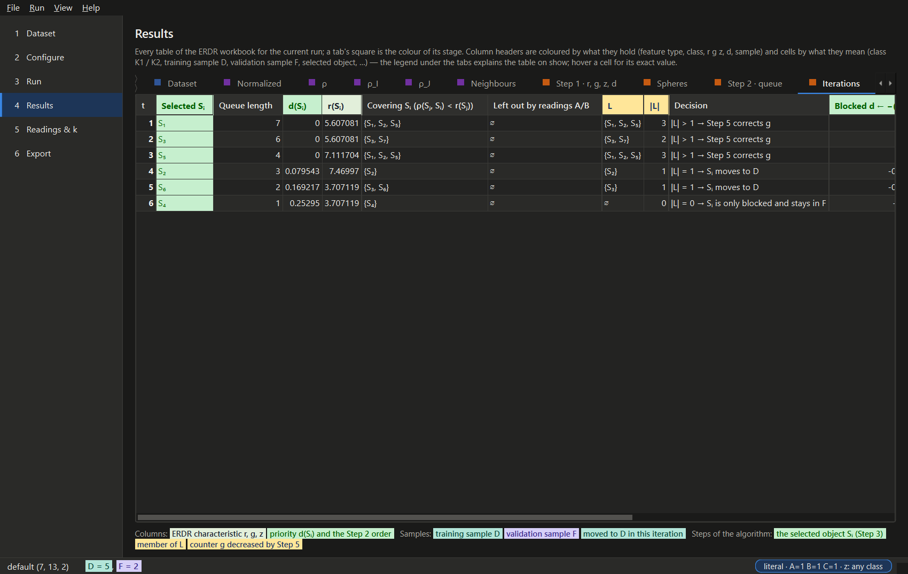

# Desktop application

`erdr gui` (or `erdr-gui`, or the portable `erdr-gui.exe`) opens the default dataset. The pages
follow the workflow — **Dataset → Configure → Run → Results → Readings & k → Export** — and the
application computes nothing itself: a run, an analysis and an export are the services in a
worker thread, and the tables and figures on screen are the exporters' own (ADR-012).

## Appearance

The application has the design of the template project's desktop application — the same
colours, 10 pt base font, spacing, numbered page list, cards, buttons and tables (ADR-018).

| | |
|---|---|
| **View → Light theme** (default) · **Dark theme** · **Follow Windows** | **Ctrl+T** switches between light and dark |
| **View → Zoom in / Zoom out / Actual size** | **Ctrl++ / Ctrl+− / Ctrl+0** (85 % … 175 %) |
| **Ctrl+1 … Ctrl+6** | the pages; **F5** runs ERDR; **Ctrl+C** copies selected table cells |

The theme, the zoom and the window's size are remembered. `erdr gui --theme dark` (or
`erdr-gui.exe --theme dark`) chooses the theme from the command line. The status bar shows the
reading as a badge — `literal`, `closest` or `custom` — and a ⚠ badge whenever a switch differs
from the literal article text; a click opens Configure.

## Colours

One colour per meaning, the same on screen, in the Excel workbook, in the HTML report, in the
figures and in the console (ADR-019). The colours are the ERDR workbook's legend; a legend under
every table names the ones it uses, and hovering a cell or a column header explains its colour.

| Colour | Meaning |
|---|---|
| light blue · light yellow column header | quantitative feature (set I) · nominal feature (set J) |
| pink column header | the class label |
| blue · orange cell (K3 aqua, …) | an object of class K1 · K2 — the colours of the classes in every figure |
| aqua · violet | training sample D · validation sample F (also in the sample-sizes figure) |
| light green · green column header | ERDR characteristic r, g, z · priority d(Sᵢ) and the queue position |
| lavender | a parameter or setting (A, B, C, z, k, the reading; the Run page's settings) |
| green cell | the selected object Sᵢ, own class inside the enemy sphere, the literal reading, a case that occurs |
| yellow cell | member of L, a counter lowered by Step 5, a Step 2 order decided by r |
| red cell | an enemy (another class); a case that does not occur, a k the rule does not permit |
| orange | **⚠ not the literal article reading** — a switch, a reading, a badge |

The tabs of the Results page carry the colour of their stage, as the workbook's sheet tabs do:
the data blue, Step 0 purple, Steps 1–5 orange, Step 6 and the charts green. The tints keep
their light fill and dark ink in the dark theme.

## Dataset

Choose a dataset of the project's folder or a built-in one, or open any file (extended layout,
CSV, Excel, the ERDR workbook). The summary shows the feature types and the classes in their
colours, the permitted k, and a bar of the class sizes; the table's headers show each feature's
type, its last row the type flags, and the class column every object's class.

## Configure

Step 0 (normalizer, metric — with a parameter form generated from the plug-in — feature selection,
rounding) and Steps 1–6 (k with the k rule, ε, the readings A, B, C and the scope of z). The title
row shows which preset the settings match — `literal`, `closest` or `custom` — next to the
*Literal preset*, *Closest preset* and *Reset* buttons; a ⚠ box at the top names every switch that
differs from the literal article text, and such a switch — and the preset badge — turns orange.
**File → Open configuration… / Save configuration as…** read and write configuration files.

## Run

Runs in the background; the log shows every stage. *Save a run folder* writes a repeatable run.

## Results

Every table of the ERDR workbook for the run — key results, the data, ρ (and ρ_I, ρ_J), the
neighbour ranks, Step 1, the enemy spheres, the queue with its tie criteria, the iterations, the
counters, D and F with every object's route, the class composition and the 17 cases — and the
figures. Headers are coloured by what a column holds and cells by what they mean (see
[Colours](#colours)); the legend under the tabs follows the open table. Hover a cell for its exact
value.

## Readings & k

Compare every reading of A, B, C (optionally with the own-class z) and sweep k for the literal,
the closest and the current reading — on all 270 objects this reproduces the workbook's
comparison with the article's Table 1. Switch values of the article's text are green, the others
orange; in the figures the literal reading is green and the closest blue, whichever readings are
shown.

## Export

Choose the formats and a folder; the readings comparison and the k sweep can be included.

## The portable executable

`scripts\build_exe.py` freezes the application with PyInstaller into `dist\erdr-gui\` (a folder,
copied as a whole; nothing is installed) and `dist\erdr-gui-<version>-windows.zip`, then runs
`erdr-gui.exe --self-test` in an empty folder — the built-in default dataset, a run that must give
the workbook's D, a table, a figure, the readings and every export format (ADR-013). CI builds it
on every push and attaches it to each release.

The screenshots are made by `scripts\gui_screenshots.py`.
