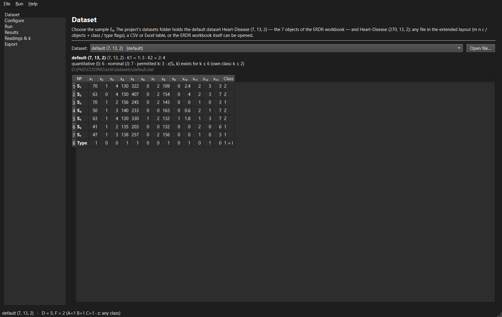
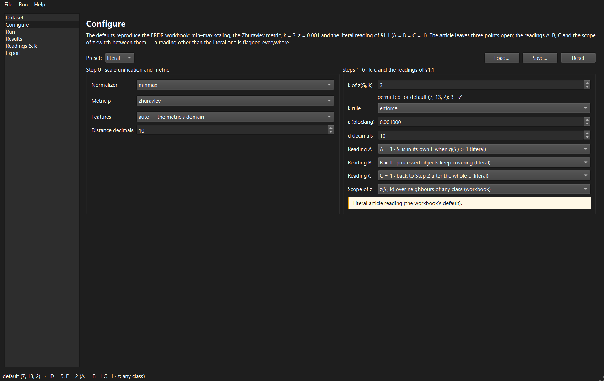
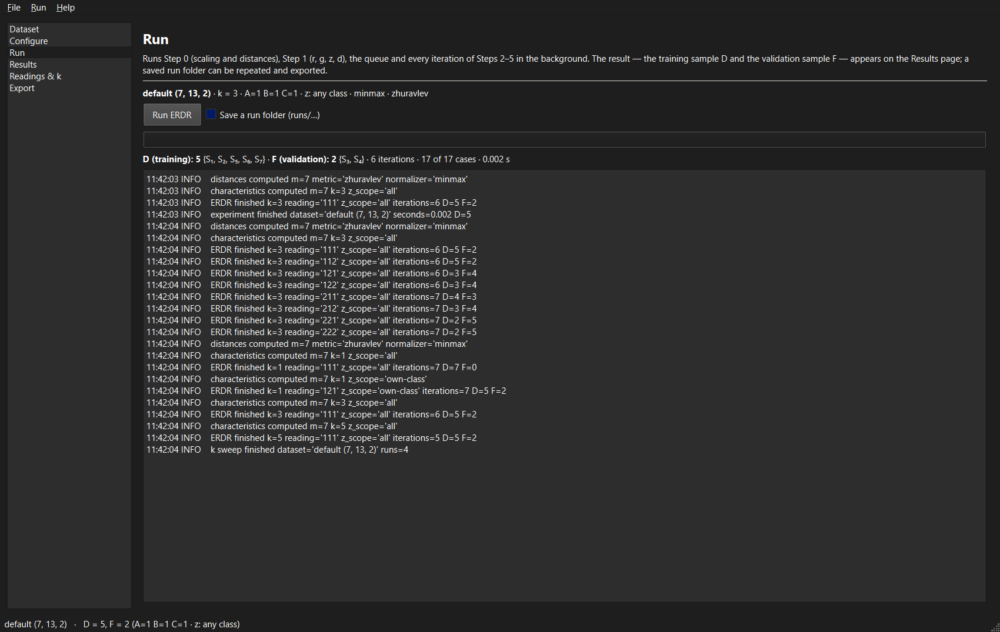
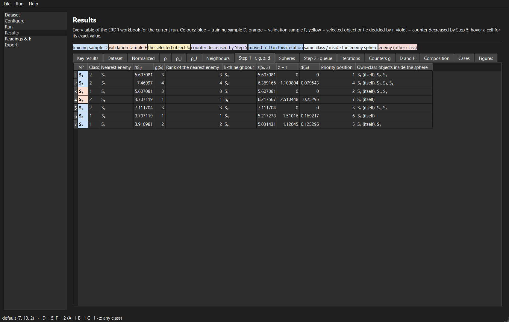
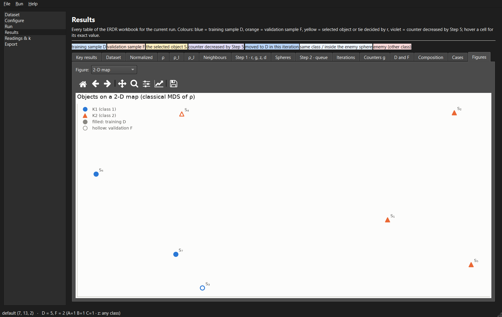
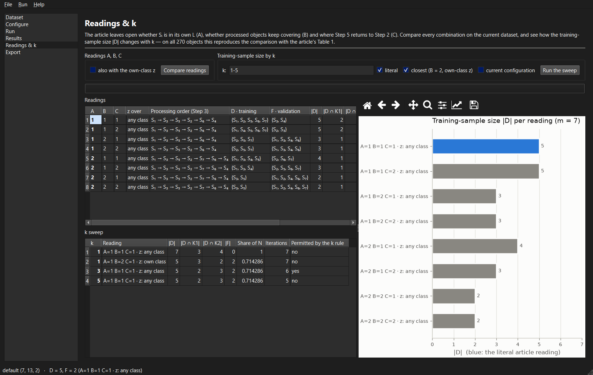
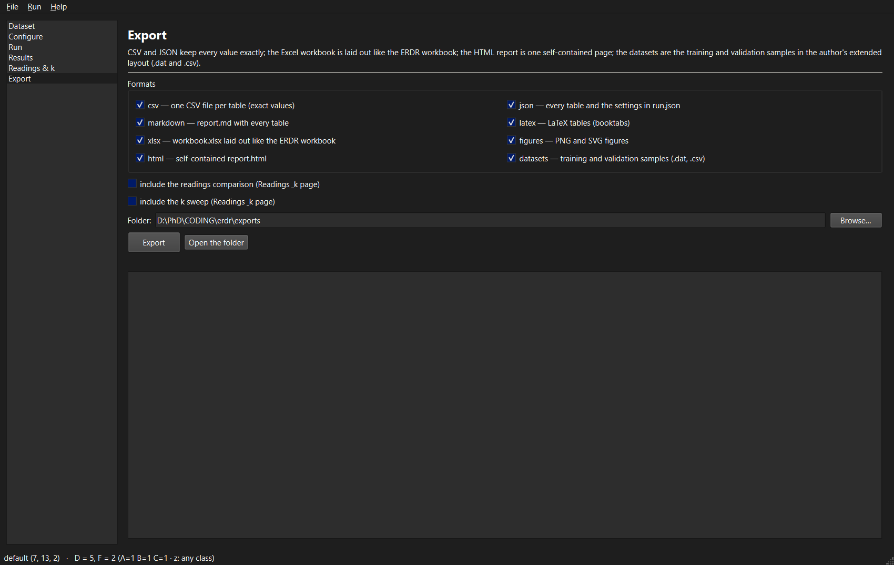

# Desktop application

`erdr gui` (or `erdr-gui`, or the portable `erdr-gui.exe`) opens the default dataset. The pages
follow the workflow — **Dataset → Configure → Run → Results → Readings & k → Export** — and the
application computes nothing itself: a run, an analysis and an export are the services in a
worker thread, and the tables and figures on screen are the exporters' own (ADR-012). The window
follows the Windows light or dark theme.

## Dataset

Choose a dataset of the project's folder or a built-in one, or open any file (extended layout,
CSV, Excel, the ERDR workbook). The summary shows the class sizes, the feature types and the
permitted k.

## Configure

Step 0 (normalizer, metric — with a parameter form generated from the plug-in — feature selection,
rounding) and Steps 1–6 (k with the k rule, ε, the readings A, B, C and the scope of z). The
preset box shows `literal`, `closest` or `custom`; a non-literal reading is flagged. Load… and
Save… read and write configuration files.

## Run

Runs in the background; the log shows every stage. *Save a run folder* writes a repeatable run.

## Results

Every table of the ERDR workbook for the run — key results, the data, ρ (and ρ_I, ρ_J), the
neighbour ranks, Step 1, the enemy spheres, the queue with its tie criteria, the iterations, the
counters, D and F with every object's route, the class composition and the 17 cases — and the
figures. Colours: blue = training sample D, orange = validation sample F, yellow = the selected
object or a tie decided by r, violet = a counter lowered by Step 5. Hover a cell for its exact
value.

## Readings & k

Compare every reading of A, B, C (optionally with the own-class z) and sweep k for the literal,
the closest and the current reading — on all 270 objects this reproduces the workbook's
comparison with the article's Table 1.

## Export

Choose the formats and a folder; the readings comparison and the k sweep can be included.

## The portable executable

`scripts\build_exe.py` freezes the application with PyInstaller into `dist\erdr-gui\` (a folder,
copied as a whole; nothing is installed) and `dist\erdr-gui-<version>-windows.zip`, then runs
`erdr-gui.exe --self-test` in an empty folder — the built-in default dataset, a run that must give
the workbook's D, a table, a figure, the readings and every export format (ADR-013). CI builds it
on every push and attaches it to each release.

The screenshots are made by `scripts\gui_screenshots.py`.
