# Visualizations

Every figure of a run, from the input data to the result — what it shows, how to read it and
where it is. The figures are drawn once (`erdr.export.figures`) and shown everywhere: the desktop
application, the PNG/SVG files, the Excel workbook and the HTML report (ADR-012). In every figure
of a run the colour is the class (K1 blue, K2 orange, …), told again by the marker shape, so
nothing rests on colour alone (ADR-019); the training sample D is aqua and the validation sample F
violet; a reading keeps one colour (literal green, closest blue).

`scripts\doc_figures.py` draws the images of this page from the default experiment.

## Where they are

| Figure | Stage | Desktop application | Export (`figures/`) | Excel sheet · HTML |
|---|---|---|---|---|
| 2-D map | data, Step 0 | Results → Figures | `map.png`, `.svg` | *Charts* · top |
| r and z per object | Step 1 | Results → Figures | `radii` | *Charts* · top |
| Hyperspheres of every object | Step 1 | Results → Figures; Hyperspheres → *the spheres of an object* | `hyperspheres`, `hyperspheres/object-N` | *Hyperspheres (Step 1)* · before the sphere tables |
| Neighbourhood strips | Step 1 → 2 | Results → Figures; Hyperspheres → *strips* | `strips` | *Hyperspheres (Step 1)* |
| Radius plane | Step 1 → 2 | Results → Figures; Hyperspheres → *radius plane* | `radius-plane` | *Hyperspheres (Step 1)* |
| Step 2 priorities | Step 2 | Results → Figures | `priorities` | *Charts* · top |
| Hyperspheres in every iteration | Steps 2–5 | Results → Figures; Hyperspheres → *the spheres around Sᵢ in an iteration* (◀ ▶, Play) | `iteration-spheres`, `iteration-spheres/iteration-N`, `iteration-spheres.gif` | *Hyperspheres (Iterations)* · before the iteration tables |
| Sample sizes | Steps 2–6 | Results → Figures | `sizes` | *Charts* · top |
| Class composition | Step 6 | Results → Figures | `composition` | *Charts* · top |
| Readings, k sweep | readings A, B, C; k | Readings & k | `readings`, `sweep` | *Charts* · top |

`erdr spheres` prints the sphere tables and saves the sphere figures: `--object S2`,
`--iteration 2`, `--figure file.png|svg` ([Command line](cli.md#erdr-spheres)).

## The data and Step 0

**2-D map** — a classical multidimensional scaling of the distances ρ: positions are
approximate. Filled markers are in D, hollow ones in F.

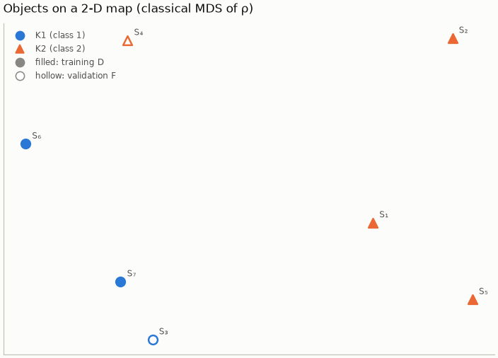

## Step 1 · r, g, z, d

**r and z per object** — the enemy radius r(Sᵢ) (filled ●) and the k-th neighbour's distance
z(Sᵢ, k) (hollow ◇); the bar between them is |z − r|, the numerator of d.

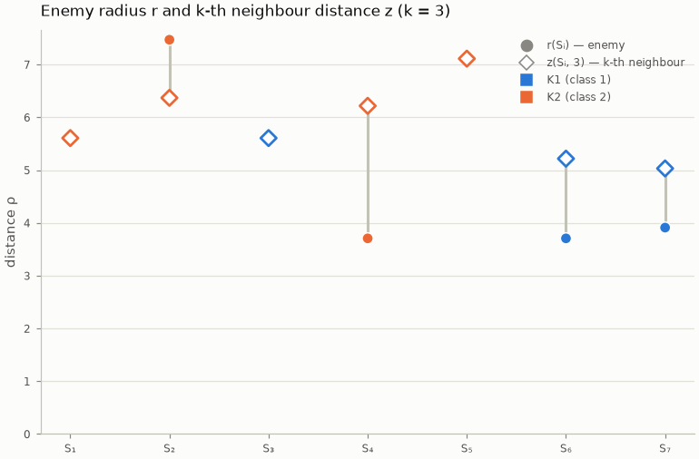

**Hyperspheres of every object** — Sᵢ in the centre, every other object at its true distance ρ,
in Sᵢ's neighbour order clockwise from the top; only the distance from the centre is meaningful.
The solid, shaded circle is the enemy sphere (through the nearest enemy, marked *r*): the filled
markers inside are the own-class objects g(Sᵢ) counts (with Sᵢ). The dashed circle is the
k-sphere (through the k-th neighbour, marked *z*). The two circles coincide when d = 0. All the
diagrams have one scale (ρ_max), so they can be compared; a sample of more than 12 objects shows
the first 12 of the Step 2 queue.

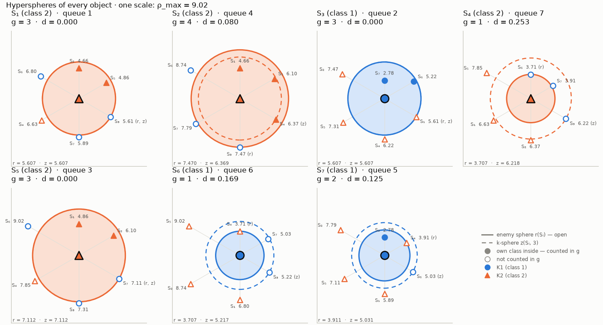

**Neighbourhood strips** — one strip per object, the first of the Step 2 queue at the top; every
neighbour at its distance. The solid tick above a strip is r, the dashed tick below it z: the
closer the two ticks, the smaller d and the earlier the object in the queue.

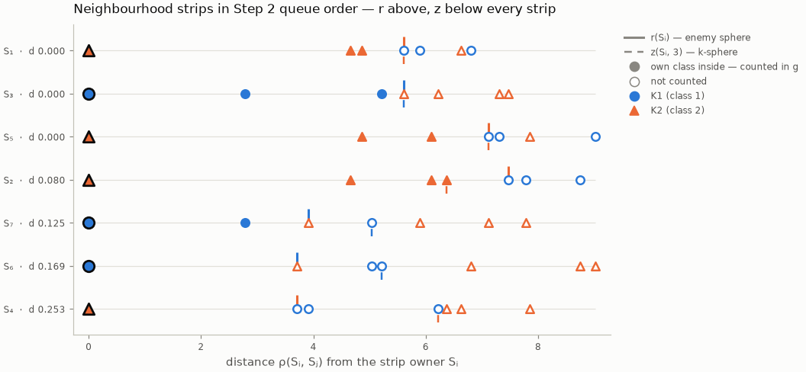

**Radius plane** — every object at (r, z). d is constant along every line through the origin:
on the diagonal z = r (d = 0), below it the k-sphere lies inside the enemy sphere (z < r), above
it the nearest enemy lies inside the k-sphere (z > r). Objects on one point tie in d and r — here
S₁ and S₃, which Step 2 orders by the index (case 5).

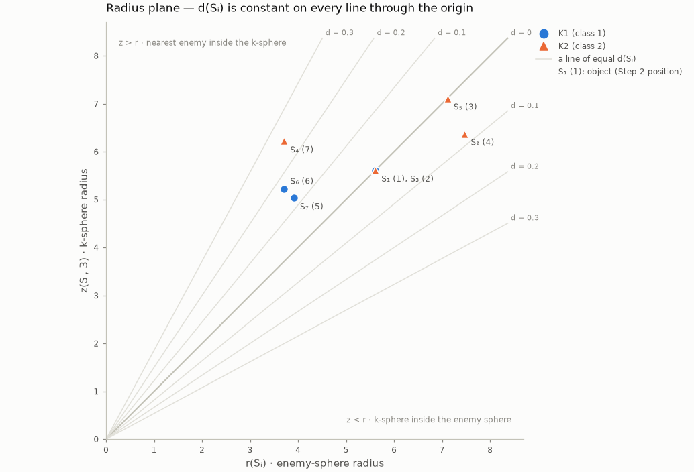

## Step 2 · the queue

**Priorities** — d(Sᵢ) in queue order, the first object at the top.

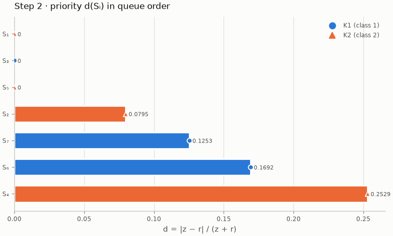

## Steps 3–5 · the iterations

**Hyperspheres in every iteration** — the selected Sᵢ in the centre (dark ring), every object at
its true distance ρ(Sⱼ, Sᵢ). Every object of Sᵢ's class carries its own enemy sphere, so a sphere
contains the centre exactly when ρ(Sⱼ, Sᵢ) < r(Sⱼ) — the condition of Step 4:

- **solid with the yellow of L** — Sⱼ ∈ L: in F, its sphere contains Sᵢ, g(Sⱼ) > 1 and the
  readings A and B allow it;
- **dashed** — own class in F, not in L (its sphere does not reach Sᵢ, or reading B leaves it out);
- **dotted** — own class already in D: its sphere no longer counts.

Filled markers are already in D, hollow ones in F; labels show the counters g before → after and
the moves to D. Above 36 objects only the spheres that contain Sᵢ are drawn.

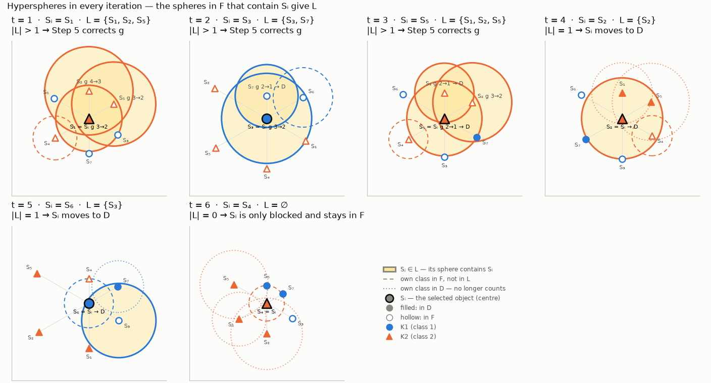

The desktop application steps through the iterations (◀ ▶ or **Play**) with each iteration's
table and summary; the export animates them:

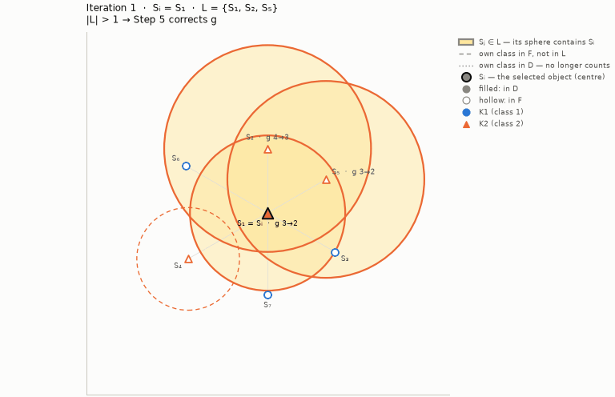

**Sample sizes** — |F|, |D| and the queue after every iteration, in the colours of F and D.

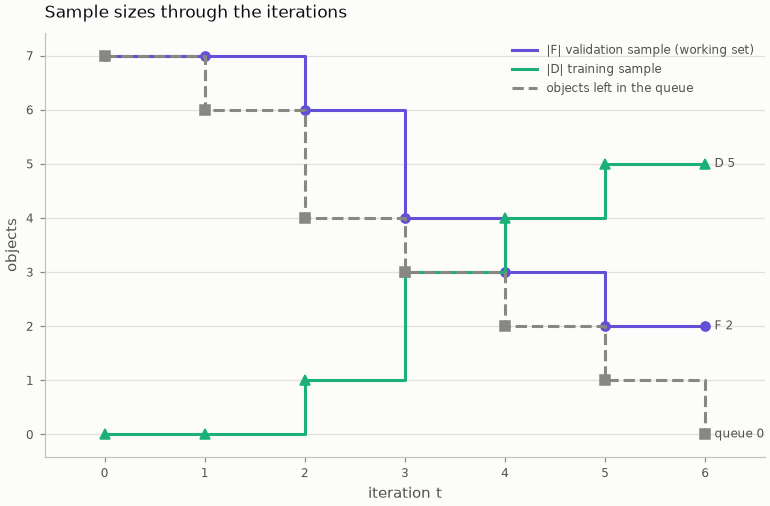

## Step 6 · the result

**Class composition** — the objects of every class in D and in F.

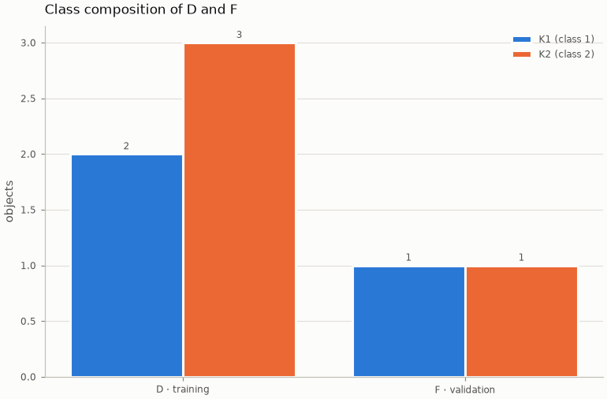

## The desktop application

The **Hyperspheres** tab of the Results page explores Steps 1–5: choose the spheres of an object,
the spheres around Sᵢ in an iteration, the strips or the radius plane; step with ◀ ▶ or **Play**.
The table under the figure is the matching block of the workbook, with its legend; a double click
on an object's or an iteration's row of any table opens it here.

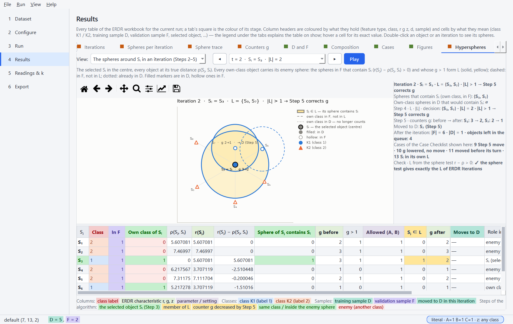
